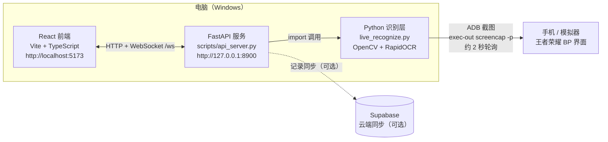

# 王者 BP 助手（v3.0）

实时辅助 BP（Ban/Pick）工具：**ADB 抓屏 → 自动识别 ban/pick → 智能推荐 → 自动记录对局**。
集成天元之弈梯度数据，支持个人战绩追踪、对局复盘与识别素材人工核对。

> 文档导航：[架构说明](./docs/ARCHITECTURE.md) · [用户手册](./docs/USER_GUIDE.md) · [文档索引](./docs/INDEX.md) · [真机测试清单](./TEST_GUIDE.md)

---

## 功能特性

- **实时 BP 识别**：ADB 自动抓屏，自动识别阶段 / ban / pick，无需手动导入
- **智能推荐**：按分路缺口分组，结合克制关系、梯度评分、协同/冲突实时推荐
- **阵容分析**：BP 完成后生成双方阵容评估、克制矩阵与建议
- **自动记录**：BP 完成自动建草稿记录，结算自动回填胜负 / MVP / 我的英雄
- **数据看板**：133 英雄梯度、登场率、禁用率、胜率统计；个人英雄胜率追踪
- **核对页（10-29 新增）**：人工核对裁切/识别结果，✓/✗ 标注 + 备注，导出 CSV/JSON，大图预览与快捷键
- **手动修正**：点任意 ban/pick 位可改，识别结果不覆盖手填值；`Ctrl+Z` 撤销、`Ctrl+Shift+R` 重置
- **记录管理**：编辑、筛选、导出 Excel（`BP记录_YYYY-MM-DD.xlsx`）

---

## 快速开始

### 环境要求

| 项 | 要求 |
|---|---|
| 系统 | Windows 10/11 |
| Python | 3.11+ |
| Node.js | 18+ |
| ADB | 默认 `D:\scrcpy\adb.exe`，或 PATH 中的 `adb` |
| 手机 | 安卓，开启「开发者选项 → USB 调试」 |

### 安装

```powershell
# 前端依赖
npm install

# Python 依赖（国内镜像）
python -m pip install -r requirements.txt -i https://pypi.tuna.tsinghua.edu.cn/simple
```

### 启动

```powershell
# 方式一：一键启动（推荐）
#   启动v3.0.bat   日常使用（后台运行，自动打开浏览器）
#   调试启动.bat   测试用（保留 API 日志窗口，排查识别问题）

# 方式二：手动启动
python scripts/api_server.py --port 8900      # 终端 1：API 识别服务
npm run dev                                    # 终端 2：前端（Vite，:5173）
# 若 npm 脚本异常，可直接：
node node_modules\vite\bin\vite.js
```

| 地址 | 用途 |
|---|---|
| http://localhost:5173/ | Web 控制台 |
| http://127.0.0.1:8900/docs | API 文档（Swagger） |

### 使用流程

```text
1. 左栏「设备」下拉选手机 → 点「开始识别」
2. 进游戏 BP → 看板自动填充 ban/pick，右侧推荐实时更新
3. BP 完成 → 自动建草稿记录，点选「我的英雄」（巅峰赛自动识别）
4. 打完一局 → 结算界面自动回填胜负 / MVP
5. 识别有误 → 手动修正，或到「核对」页标注错误帧后导出反馈
```

详细操作见 [用户手册](./docs/USER_GUIDE.md)。

---

## 架构



数据流：`ADB 截图 → 阶段/ban/pick/楼层/结算识别 → WebSocket 推送 state → 前端看板与推荐 → 自动建记录/回填`。
完整的组件职责、识别原理与 API 端点见 [docs/ARCHITECTURE.md](./docs/ARCHITECTURE.md)。

### 识别能力

| 能力 | 方法 | 实测 |
|---|---|---|
| BP 阶段 | 帧差缓存 + OCR 顶部横幅 + 模板兜底 | 58/58（含 5 种分辨率） |
| ban 位 | HoughCircles 自适应 + ORB/颜色融合 + 固定坐标兜底 | 真机金标准 10/10 检出 |
| pick 位 | 固定比例坐标 + 空位判断（final 阶段识别） | 金标准 10/10 逐位全对 |
| 玩家阵营 | 左侧框红色像素比例 | 稳定 |
| 玩家楼层 | OCR 金色昵称 | 3/4（仅巅峰赛） |
| 结算结果 | OCR 巅峰积分变化符号 | WIN / LOSE / MVP / delta 全对 |
| 结算英雄 | MVP 圆形头像匹配 | MVP 画面准确 |

**识别策略要点**：`pick`（选人界面）不识别 pick 位（队伍头像是预选），只补 ban；`final`（最后调整）是权威数据源，识别最终 picks + 投票补全 10 个 ban。

---

## 测试

测试脚本均在 `scripts/`，前缀 `_` 的文件不会被业务打包。

| 套件 | 命令 | 覆盖 | 用例数 |
|---|---|---|---|
| 识别函数 | `python scripts/_test_recognize.py` | 阶段 / ban / pick / 楼层 / 结算 / 缓存 | 107 |
| API 端点 | `python scripts/_test_api.py` | 设备、状态、BP、错误分支、CORS | 27 |
| 数据一致性 | `python scripts/_test_data.py` | 133 英雄字段、引用、双份 JSON、头像 | 23 |
| 前端运行时 | `node scripts/_test_frontend.mjs` | 三 Tab 渲染、控制台错误、溢出（Edge headless + CDP） | 15 |
| 链路测试 | `node scripts/_test_pipeline.mjs` | store 状态机 / 记录闭环 / 持久化（Node mock localStorage） | 21 项 |
| 真机帧回归 | `python scripts/_test_real_frames.py` | `_diag/live_*.png` 真机帧批量识别，改动后对比结果 | 依帧数 |

最近一轮全盘测试（2026-10-28）：**172 用例 / 170 通过（98.8%）**，无 P0；详情见 [docs/TEST_REPORT_2026-10-28.md](./docs/TEST_REPORT_2026-10-28.md)。

> 识别函数套件跑完整 OCR 较慢（约 10~12 分钟），可用 `--phase` / `--bans` / `--picks` / `--floor` / `--result` 只跑子集。

---

## 真机连接

```powershell
# 1. 手机开 USB 调试，数据线连接，手机上点「允许 USB 调试」
# 2. 确认设备在线（输出应为 <serial>  device）
D:\scrcpy\adb.exe devices

# 3. 页面左栏「设备」下拉选设备 → 点「开始识别」
```

- **无线调试（可选）**：页面「设备配置」→ WiFi 连接，填手机 IP + 端口 5555；或先 USB 执行 `adb tcpip 5555` 后拔线。
- **投屏（可选）**：双击 `启动投屏.bat`（scrcpy 镜像，不影响识别）。
- 常见问题排查见 [用户手册 §常见问题](./docs/USER_GUIDE.md#10-常见问题) 与 [TEST_GUIDE.md](./TEST_GUIDE.md)。

---

## 目录结构

```text
.
├── scripts/
│   ├── api_server.py            # FastAPI 服务（:8900，抓帧 worker + 识别调度 + 核对接口）
│   ├── live_recognize.py        # 识别核心（阶段/ban/pick/阵营/楼层/结算）
│   ├── recognize_screenshot.py  # HoughCircles 圆形检测 + 头像裁剪 + 锁检测
│   ├── live_bp.py               # 命令行实时识别（调试用）
│   ├── adb_console.py           # v2.0 tkinter 控制台（保留）
│   ├── sync_heroes.py           # 英雄数据同步
│   └── _test_*.py / *.mjs       # 测试套件与诊断脚本
├── src/
│   ├── pages/Home.tsx           # 主界面（4 Tab：BP 模拟 / 数据看板 / 记录 / 核对）
│   ├── components/              # BpStage / AdbControlPanel / ReviewPanel / BpRecords / RecordEditModal ...
│   ├── hooks/useBpSync.ts       # 识别结果 → bpStore 同步（增量写入，保留手动修改）
│   ├── store/                   # bpStore（BP 状态）/ bpRecordStore（记录）
│   ├── services/recommendation/ # 推荐算法（分路缺口 / 克制 / 阵容结构）
│   ├── data/heroes.json         # 133 英雄数据（public/data 为运行时副本）
│   └── ...
├── models/templates/            # 阶段识别模板（ban/pick/final/match_other）
├── assets/lane_icons/           # 分路图标模板（选人界面未选位过滤）
├── avatars/                     # 133 英雄头像（gitignore，用 sync_heroes.py 重建）
├── src-tauri/                   # Tauri v2 桌面端（可选）
├── supabase/schema.sql          # 云端表结构
├── docs/                        # 文档（索引见 docs/INDEX.md）
├── _diag/                       # 运行诊断：recog.log / live_*.png（150 张上限）/ review.json
├── 启动v3.0.bat                 # 一键启动（后台）
├── 调试启动.bat                 # 一键启动（带 API 日志）
└── TEST_GUIDE.md                # 真机测试清单
```

---

## 文档

| 文档 | 内容 |
|---|---|
| [docs/USER_GUIDE.md](./docs/USER_GUIDE.md) | 用户手册：启动、连手机、BP 页、核对页、记录页、常见问题 |
| [docs/ARCHITECTURE.md](./docs/ARCHITECTURE.md) | 架构图、识别链路、21 个 API 端点、数据存储、部署形态 |
| [docs/INDEX.md](./docs/INDEX.md) | 文档归档索引（当前有效 vs 历史归档） |
| [docs/RECOMMENDATION_DESIGN.md](./docs/RECOMMENDATION_DESIGN.md) | 推荐算法设计（分路驱动 / 克制加权 / 阵容结构） |
| [TEST_GUIDE.md](./TEST_GUIDE.md) | 真机测试清单（历史，操作步骤仍可参考） |

---

## 已知限制

| 限制 | 说明 |
|---|---|
| 玩家楼层识别 3/4 | 聊天消息会干扰 OCR 分行；仅巅峰赛金色昵称有效 |
| 排位局楼层不适用 | 排位我方名字是白色，只对巅峰赛有效 |
| 非 MVP 结算无玩家头像 | 「我的英雄」需手动确认（我方 5 个一键点选） |
| 选人界面不识别 pick | 队伍头像是预选，等「最后调整」填最终阵容 |
| 低置信英雄 | 前端显示「?」（绿发类孙膑/庄周/蔡文姬识别较弱），需人工修正 |
| 分路图标 vs 盾山 | 视觉相似，按阶段区分：pick 阶段过滤、final 不过滤 |
| API 地址硬编码 | 前端写死 `http://127.0.0.1:8900`，改端口需改代码 |
| 硬件开销 | 2 秒轮询 + OCR，识别期间 CPU 偏高 |

---

## 版本历史

- **v3.0**（当前）：Web 控制台 + ADB 实时识别 + 全链路闭环 + 核对页/记录编辑/Excel 导出
- **v2.0**：ADB 识别 + tkinter GUI 控制台 + 样本采集（tag: v2.0）
- **v1.0**：基础 BP 模拟 + 推荐（tag: v1.0）
