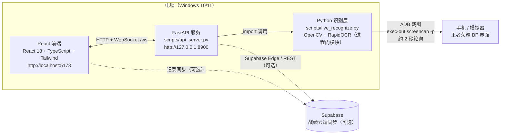
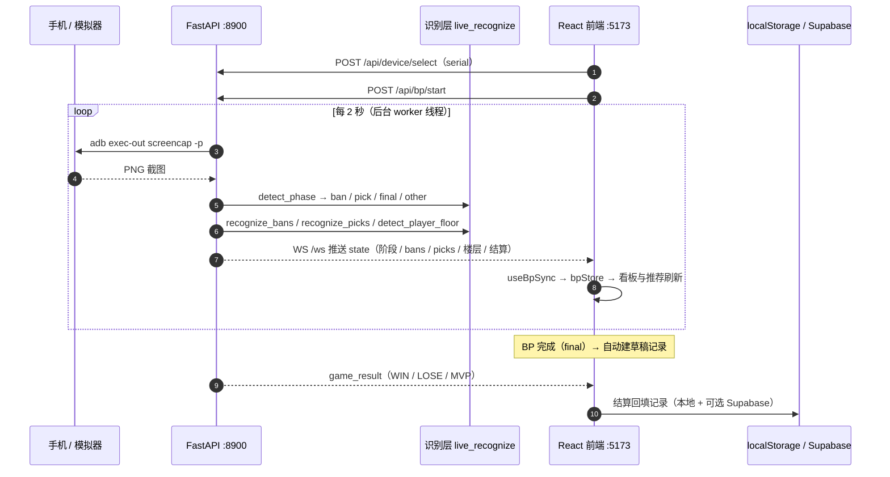

# 架构说明（v3.0）

> 更新：2026-10-29 · 对应代码：`master`（当前最新 commit 见 git log）
> 相关：[用户手册](./USER_GUIDE.md) · [文档索引](./INDEX.md) · [推荐算法设计](./RECOMMENDATION_DESIGN.md)

一句话：**ADB 抓手机画面 → Python 识别 BP 状态 → FastAPI 推给 React 看板 → 自动建记录 / 结算回填。**

---

## 1. 系统架构

### 组件职责

| 组件 | 位置 | 职责 |
|---|---|---|
| **React 前端** | `src/`（Vite，:5173） | BP 看板 / 智能推荐 / 阵容分析 / 记录 / 数据看板 / 核对页；通过 HTTP + WebSocket 与 API 通信 |
| **FastAPI 服务** | `scripts/api_server.py`（:8900） | 设备管理、抓帧 worker、识别调度、状态广播（WS）、核对页接口、数据同步 |
| **Python 识别层** | `scripts/live_recognize.py` 等 | 阶段 / ban / pick / 阵营 / 玩家楼层 / 结算 / 结算英雄识别，可独立调用的 Python 模块（不含 HTTP 依赖），被 API 进程 import |
| **ADB** | 默认 `D:\scrcpy\adb.exe`（找不到则用 PATH） | 设备枚举（`adb devices`）、截屏（`adb exec-out screencap -p`） |
| **Supabase** | `supabase/schema.sql` + `src/lib/supabase.ts` | 可选云端同步（`.env` 配置，未配置则仅本地 localStorage） |
| **Tauri 桌面端** | `src-tauri/` | 可选打包形态（已产出 `王者BP助手_1.0.0_x64-setup.exe`），前端代码不变 |

### 技术栈

| 层 | 技术 |
|---|---|
| 前端 | React 18 · TypeScript · Tailwind CSS · Vite 6 · Zustand 5 · Recharts · framer-motion |
| 识别 | Python 3.11 · OpenCV · NumPy · RapidOCR（onnxruntime） · ORB + 颜色特征融合 |
| 服务 | FastAPI · uvicorn · WebSocket |
| 数据 | 本地 `heroes.json`（133 英雄）· localStorage · Supabase（可选） |
| 桌面 | Tauri v2（Rust，可选） |

---

## 2. BP 识别链路（时序）

**关键节点**

- BP 完成：前端检测到双方 ban/pick 齐 → `AnalysisSummary` 自动建草稿记录（同一局去重）。
- 结算回填：非 BP 阶段每 6 秒检测一次结算界面，识别 `WIN/LOSE`、`MVP`、巅峰积分变化；MVP 局额外识别结算头像作为「我的英雄」。
- 记录持久化：`bpRecordStore` 写 localStorage，配置 Supabase 后自动上传。

---

## 3. 识别层工作原理

### 3.1 阶段识别（`detect_phase`）

| 顺序 | 方法 | 说明 |
|---|---|---|
| ① | 帧差缓存 | 顶部横幅缩略图（160×45）平均差 < 3.0 → 直接复用上次结果（毫秒级） |
| ② | OCR 关键词 | 识别顶部 35% 横幅，匹配 `PHASE_KEYWORDS`（禁用/选将/最后调整/准备前往/禁用结果…） |
| ③ | 模板兜底 | `models/templates/*.png`（ban / pick / pick2 / final_adjust / match_other） |

阶段取值：`ban`（禁英雄）· `pick`（选人/等待）· `final`（最后调整，BP 已完成）· `other`（其余）。

### 3.2 ban 识别（`recognize_bans`）

1. **HoughCircles 自适应找圆**（主方案）：检测顶部 5+5 个 ban 位，半径取中位数，圆心向屏幕中心微调 2px。
2. **固定比例坐标兜底**：Hough 失败时回退到预设坐标。
3. **特征匹配**：ORB + 颜色特征 RRF 融合打分 → 取 top1/top2 的 gap ≥ `CONFIDENT_GAP`（0.0025）判为高置信。
4. **空位判断**：灰度 std 低于阈值视为空位。
5. **分路图标过滤**：选人界面未选择的位置会显示分路图标（`assets/lane_icons/` 模板匹配），只在 selecting 帧过滤；final 帧不过滤（避免误伤盾山等相似英雄）。

### 3.3 pick 识别与「final 权威」策略

| 界面 | 处理 |
|---|---|
| ban 阶段 | 识别 ban；出结果时存诊断帧 |
| **pick 阶段（选人界面）** | **不识别 pick**（队伍头像是玩家预选，不是最终阵容），但会多帧投票补顶部 ban、清空上一局残留 picks |
| **final（最后调整）** | **权威数据源**：识别 10 个 pick + 投票补全 10 个 ban（丢弃 pick 阶段的临时 ban） |

多帧投票：按 `(side, index)` 累计英雄出现次数，解决单帧抖动；final 帧不足时用最后一帧兜底。

### 3.4 其他识别

| 能力 | 方法 |
|---|---|
| 玩家阵营 | 判定框左侧红色像素比例（`detect_user_side`） |
| 玩家楼层 | OCR 金色昵称（`detect_player_floor`，仅巅峰赛匿名昵称有效，约 3/4） |
| 结算结果 | OCR 巅峰积分变化符号 → WIN / LOSE、MVP、delta |
| 结算英雄 | MVP 画面圆形头像匹配（`detect_result_hero`，阈值 0.0012） |

### 3.5 置信度与人工兜底

- `confident=false` 时前端显示「?」，不写入「我的英雄」等关键字段。
- 前端 `useBpSync` **增量写入**：已有值与识别结果不同 → 视为用户手动修改，**保留不覆盖**。
- 新一局检测带防抖：连续 3 次（约 6 秒）bans 为空才 reset，避免识别抖动清空用户数据。

---

## 4. API 端点（服务 :8900，文档 `/docs`）

### 设备 / 状态

| 方法 | 路径 | 说明 |
|---|---|---|
| GET | `/api/health` | 健康检查（ok / version / time） |
| GET | `/api/devices` | 设备列表（adb devices） |
| POST | `/api/device/select` | 选择设备 `{serial}` |
| POST | `/api/device/connect` | WiFi 连接 `{ip, port?}` |
| POST | `/api/device/disconnect` | 断开 WiFi 设备 |
| GET | `/api/state` | 当前状态（阶段 / bans / picks / 楼层 / 结算 / error 等） |
| GET | `/api/phase` | 抓一帧识别阶段 |
| POST | `/api/capture` | 抓一帧返回 PNG |
| POST | `/api/recognize/once` | 抓一帧完整识别一次 |
| WS | `/ws` | 状态推送（首帧 `{type:"state", data:{...}}`） |

### BP / 数据

| 方法 | 路径 | 说明 |
|---|---|---|
| POST | `/api/bp/start` | 启动后台识别 worker（2 秒轮询） |
| POST | `/api/bp/stop` | 停止识别 |
| POST | `/api/data/sync` | 同步英雄数据（执行 `sync_heroes.py`） |
| GET | `/api/heroes` | 133 英雄数据 |

### 核对页（10-29 新增）

| 方法 | 路径 | 说明 |
|---|---|---|
| GET | `/api/review/frames?limit=80` | 诊断帧列表（最新在前，按 mtime） |
| GET | `/api/review/crop?frame=X&kind=ban&side=blue&index=1` | 单裁切位（放大 4 倍 base64）+ 识别结果（hero/confident/gap/lane_icon） |
| GET | `/api/review/frame_raw?frame=X` | 原始帧（大图预览） |
| GET | `/api/review/marks` | 全部标注 |
| GET | `/api/review/summary` | 进度摘要（总帧数 / 已标注 / 已全标 / 标注总数） |
| GET | `/api/review/export?format=json\|csv` | 导出标注（CSV 带 BOM，Excel 可直接打开） |
| POST | `/api/review/mark` | 保存标注 `{frame, kind, side, index, correct, note}` |

---

## 5. 数据与存储

| 数据 | 位置 | 说明 |
|---|---|---|
| 英雄数据 | `src/data/heroes.json` + `public/data/heroes.json` | 133 英雄，两份内容一致（前端运行时读 public） |
| 英雄头像 | `avatars/`（133 张）+ `public/avatars/` | `sync_heroes.py` 可重建 |
| BP 状态 | `src/store/bpStore.ts`（Zustand persist） | localStorage，key 见 store |
| 对战记录 | `src/store/bpRecordStore.ts` | localStorage + 可选 Supabase |
| 识别诊断 | `_diag/recog.log` | 阶段 / ban / pick / 楼层 / 结算日志 |
| 诊断帧 | `_diag/live_*.png` | 最多保留 150 张（按 mtime 清理），核对页数据源 |
| 核对标注 | `_diag/review.json` | 核对页 ✓/✗ + 备注 |
| 云端表结构 | `supabase/schema.sql` | 记录表 / 英雄表定义 |

---

## 6. 部署形态

| 形态 | 方式 | 说明 |
|---|---|---|
| **Web 开发（日常）** | `启动v3.0.bat` 或手动 `python scripts/api_server.py --port 8900` + `npm run dev` | 浏览器访问 :5173 |
| **Tauri 桌面** | `npm run build` + Tauri CLI 打包 | 已产出 `王者BP助手_1.0.0_x64-setup.exe` |
| **静态部署** | `npm run build:web` → `dist/`（`vercel.json` / `public/_redirects` 已配 SPA 回退） | 前端可托管，但识别能力仍需本机 API |

---

## 7. 已知约束

| 约束 | 说明 |
|---|---|
| API 地址硬编码 | 前端多处写死 `http://127.0.0.1:8900`（如 `useBpSync.ts` / `AdbPreview.tsx` / `DeviceConfigModal.tsx` / `ReviewPanel.tsx`），换端口或远程调试需改代码 |
| ADB 依赖 | 默认找 `D:\scrcpy\adb.exe`，其次 PATH 中的 `adb`；需先 `adb devices` 在线 |
| 排位局楼层识别 | 仅巅峰赛金色昵称有效 |
| 2 秒轮询 | 单帧 ban 识别约 170~420ms、OCR 2~5s，CPU 偏高但可接受 |
| 识别置信度 | 低置信英雄前端显示「?」，需人工修正/核对页标注补样本 |
| 分路图标 vs 盾山 | 视觉相似，靠阶段区分：pick 阶段过滤、final 不过滤 |

---

## 8. 相关文档

- 使用操作：[USER_GUIDE.md](./USER_GUIDE.md)
- 文档索引与归档：[INDEX.md](./INDEX.md)
- 推荐算法目标设计：[RECOMMENDATION_DESIGN.md](./RECOMMENDATION_DESIGN.md)
- 历史测试结论：[TEST_REPORT_2026-10-28.md](./TEST_REPORT_2026-10-28.md) · [PIPELINE_TEST_2026-10-28.md](./PIPELINE_TEST_2026-10-28.md)
